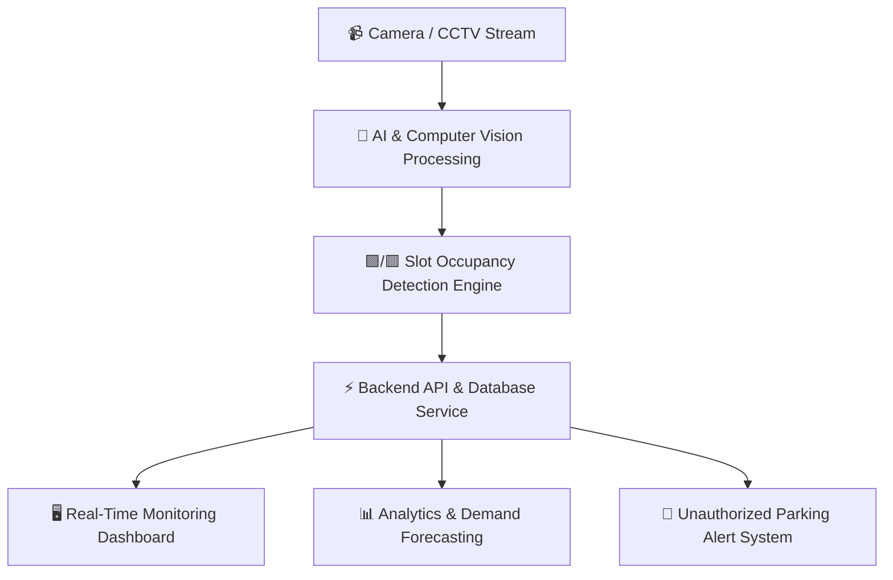

# 🚗 SpotSense: AI-Powered Smart Parking System

[](https://www.python.org/)
[](https://opencv.org/)
[]()
[]()

> **SpotSense** is an intelligent, AI-driven smart parking slot detection and management platform. By analyzing live camera feeds and CCTV footage using Computer Vision and Deep Learning, SpotSense identifies real-time parking space availability, reduces traffic congestion, and delivers data-driven analytics for parking administrators.

---

## 📌 Table of Contents

- [Overview](#-overview)
- [Problem Statement](#-problem-statement)
- [Proposed Solution](#-proposed-solution)
- [Key Features](#-key-features)
- [System Architecture](#-system-architecture)
- [Technology Stack](#-technology-stack)
- [Deployment & Target Environments](#-deployment--target-environments)
- [Getting Started](#-getting-started)
- [Future Enhancements](#-future-enhancements)
- [Keywords](#-keywords)

---

## 📖 Overview

In rapidly growing urban spaces, finding an open parking slot is often frustrating, inefficient, and time-consuming. **SpotSense** solves this challenge by leveraging **Computer Vision and Artificial Intelligence** to monitor parking lots automatically.

Instead of relying on costly physical ground sensors for every individual parking bay, SpotSense uses optical camera feeds to continuously detect whether predefined parking slots are **Vacant 🟩** or **Occupied 🟥**. The processed data is updated live on an intuitive interface accessible by drivers and parking operators.

---

## 🚨 Problem Statement

Traditional parking systems rely heavily on manual attendants or basic entry/exit gate barriers, which fail to pinpoint specific vacant parking slots inside a lot.

* **For Drivers**: High fuel consumption, wasted time, increased urban traffic congestion, and driver stress while searching for parking.
* **For Administrators**: Lack of visibility into real-time space utilization, inefficient space allocation, and absent analytics for long-term planning.

---

## 💡 Proposed Solution

SpotSense addresses these pain points by offering an end-to-end automated parking monitoring pipeline:

1. **Video Ingestion**: Captures video stream from overhead cameras or CCTV feeds.
2. **AI Inference**: Runs object detection and spatial mask overlays to classify slots as vacant or occupied.
3. **Real-Time Sync**: Updates backend databases with instantaneous slot status updates.
4. **Interactive Dashboard**: Displays live occupancy maps, availability counts, and historical usage trends.

---

## ✨ Key Features

- 📹 **Real-Time Slot Occupancy Detection**: Computer Vision models analyze live video streams to instantly detect vehicle presence.
- 🎯 **Visual Bounding & Mask Overlays**: Predefined slot bounding boxes highlight vacant (green) and occupied (red) spaces clearly.
- 📊 **Centralized Digital Dashboard**: Live monitoring for security personnel, parking administrators, and drivers.
- ☁️ **Cloud Data Management**: Secure backend services to store historical occupancy statistics and logs.
- 📈 **Predictive Parking Analytics**: Analyzes historical peak hours and usage metrics to forecast future parking demand.
- 🚨 **Security & Unauthorized Vehicle Detection**: Capability to identify improper parking or unauthorized space usage and trigger alerts.
- 🌐 **Scalable Architecture**: Flexible design supporting multiple camera feeds across multi-level parking lots.

---

## 🏗️ System Architecture



---

## 🛠️ Technology Stack

| Domain | Technologies & Libraries |
| :--- | :--- |
| **Artificial Intelligence & CV** | Python, OpenCV, Object Detection (YOLO / CNN), Image Processing |
| **Backend Services** | Python (FastAPI / Flask) / Node.js, RESTful APIs |
| **Database & Cloud** | Firebase / PostgreSQL / MongoDB |
| **Frontend & Visualization** | Web Interface (HTML5, CSS3, JavaScript / React) |
| **Data Analytics** | Pandas, NumPy, Matplotlib / Chart.js |

---

## 🏬 Deployment & Target Environments

SpotSense is adaptable for various high-density commercial and public parking facilities:
- 🏢 **Corporate & Tech Parks**
- 🛍️ **Shopping Malls & Retail Centers**
- 🎓 **University & School Campuses**
- 🏥 **Hospitals & Medical Centers**
- ✈️ **Airports, Railway Stations & Transit Hubs**
- 🏙️ **Smart City Municipal Parking Lots**

---

## 🚀 Getting Started

### Prerequisites

- Python 3.9+
- Git
- OpenCV & Deep Learning Dependencies

### Installation

1. **Clone the repository**:
   ```bash
   git clone https://github.com/DiVYA1136/Spot-Sense.git
   cd Spot-Sense
   ```

2. **Set up a virtual environment**:
   ```bash
   python -m venv venv
   # On Windows:
   venv\Scripts\activate
   # On macOS/Linux:
   source venv/bin/activate
   ```

3. **Install dependencies**:
   ```bash
   pip install -r requirements.txt
   ```

4. **Run the application**:
   ```bash
   python main.py
   ```

---

## 🔮 Future Enhancements

- 📱 **Mobile App Integration**: Mobile application for drivers to reserve or locate open slots prior to arrival.
- 🏷️ **ANPR (Automatic Number Plate Recognition)**: Automated vehicle registration tracking upon entering/exiting.
- ⚡ **EV Charging Slot Monitoring**: Dedicated status tracking for Electric Vehicle charging bays.

---

## 🏷️ Keywords

`Artificial Intelligence` • `Computer Vision` • `Smart Parking` • `Object Detection` • `OpenCV` • `Real-Time Monitoring` • `Cloud Computing` • `Parking Analytics` • `Smart City`

---

<p center>Maintained by <a href="https://github.com/DiVYA1136">DiVYA1136</a></p>