# 🚗 SpotSense: AI-Powered Smart Parking Slot Detection System

[](https://www.python.org/)
[](https://github.com/ultralytics/ultralytics)
[](https://opencv.org/)
[]()
[](LICENSE)

> **SpotSense** is an AI-driven smart parking occupancy detection and management solution. By combining **YOLOv8 deep learning vehicle detection** with **polygonal Region-of-Interest (ROI) geometric collision testing**, SpotSense delivers accurate, real-time parking space availability metrics without requiring expensive IoT ground sensors.

---

## 📌 Table of Contents

- [Overview](#-overview)
- [Key Features](#-key-features)
- [System Architecture](#-system-architecture)
- [Project Structure](#-project-structure)
- [Prerequisites & Installation](#-prerequisites--installation)
- [Quick Start Guide](#-quick-start-guide)
  - [1. Marking Custom Parking Bays](#1-marking-custom-parking-bays-test1py)
  - [2. Running Real-Time Occupancy Detection](#2-running-real-time-occupancy-detection-test2py--mainpy)
- [Interactive Controls Cheat Sheet](#-interactive-controls-cheat-sheet)
- [Detection Pipeline Details](#-detection-pipeline-details)
- [Technology Stack](#-technology-stack)
- [Roadmap & Future Enhancements](#-roadmap--future-enhancements)
- [License](#-license)

---

## 📖 Overview

Traditional parking infrastructure struggles with inefficiency, manual monitoring delays, and traffic congestion. Ground-embedded magnetic sensors are expensive to install, easily damaged, and difficult to maintain.

**SpotSense** provides an optical, camera-based solution that:
1. Employs **YOLOv8s** to accurately localize vehicles (cars, buses, trucks, vans) in CCTV camera video streams.
2. Performs real-time **point-in-polygon collision testing** (`cv2.pointPolygonTest`) to evaluate occupancy against pre-calibrated parking bays.
3. Overlays dynamic, color-coded visual feedback (**🟩 Free / 🟥 Occupied**) and a live HUD counter of available spaces.

---

## ✨ Key Features

- 🎯 **Deep Learning Vehicle Detection**: Powered by YOLOv8 for robust vehicle detection under varying lighting and camera angles.
- 📐 **Polygonal Slot Definition**: Define parking bays of any geometric shape (perspective-skewed angles, trapezoids, or standard rectangles) via mouse dragging.
- ⚡ **Optimized Video Inference**: Implements frame stride optimization (process every 3rd frame) for ultra-fast, smooth real-time performance.
- 📊 **Dynamic HUD Dashboard Overlay**: Displays instantaneous `AVAILABLE` and `OCCUPIED` bay counts directly onto the video stream.
- 💾 **Persistent Configuration**: Serializes slot boundary polygons with pickle to easily load and adjust bays without re-calibration.
- 🎮 **Unified Application CLI**: Single entrypoint `main.py` allowing instant switching between slot calibration and real-time detection modes.

---

## 🏗️ System Architecture

```mermaid
graph TD
    A["📹 Video Stream / CCTV Feed (easy1.mp4)"] --> B["⚡ Video Preprocessing & Resize (1020x500)"]
    B --> C["🧠 YOLOv8s Vehicle Detection (Cars, Trucks, Buses)"]
    C --> D["📍 Compute Vehicle Center Coordinates (cx, cy)"]
    E["📁 Saved Slot Polylines (Manasa)"] --> F["📐 Point-in-Polygon Collision Test (cv2.pointPolygonTest)"]
    D --> F
    F --> G{"Is Vehicle Inside Slot?"}
    G -- Yes --> H["🟥 Mark Slot as Occupied"]
    G -- No --> I["🟩 Mark Slot as Free"]
    H --> J["🖥️ Render HUD Overlays & Occupancy Stats"]
    I --> J
```



---

## 📂 Project Structure

```bash
Spot-Sense/
├── coco.txt          # COCO dataset class labels mapping
├── easy1.mp4         # Sample parking surveillance video footage
├── LICENSE           # MIT open source license
├── main.py           # Unified application CLI entrypoint
├── Manasa            # Calibrated parking slot polygons & bay names (Pickle)
├── requirements.txt  # Python package dependencies
├── slots.json        # Exported JSON parking slot boundaries & polygons
├── test1.py          # Interactive slot drawing & annotation tool
├── test2.py          # Real-time YOLOv8 parking slot occupancy tracker
├── utils.py          # Format converters (JSON <-> Pickle) & helper utilities
├── yolov8s.pt        # Pre-trained YOLOv8 small model weights
└── README.md         # Project documentation & usage manual
```

---

## 💻 Prerequisites & Installation

### 1. Clone the Repository
```bash
git clone https://github.com/DiVYA1136/Spot-Sense.git
cd Spot-Sense
```

### 2. Set Up a Virtual Environment (Recommended)
```bash
python -m venv venv

# On Windows:
venv\Scripts\activate

# On Linux/macOS:
source venv/bin/activate
```

### 3. Install Dependencies
```bash
pip install -r requirements.txt
```

---

## 🚀 Quick Start Guide

### 1. Marking Custom Parking Bays (`test1.py`)
If you are deploying on new camera footage or want to customize slot locations:
```bash
python main.py --annotate
# or directly:
python test1.py
```
- **How to use:**
  1. Click and hold the **Left Mouse Button** to trace around a parking bay.
  2. Release the mouse button.
  3. Enter the slot name (e.g., `1`, `A-12`, `VIP`) in the console prompt.
  4. Press `s` on the video window to save the slot configurations to `Manasa`.

---

### 2. Running Real-Time Occupancy Detection (`test2.py` / `main.py`)
Run the live detection engine:
```bash
python main.py
# or with flag:
python main.py --detect
# or directly:
python test2.py
```

The system will:
- Load the YOLOv8 model weights (`yolov8s.pt`).
- Read the calibrated parking spots from `Manasa`.
- Monitor `easy1.mp4` and display:
  - **🟩 Green Bay**: Free / Available Space.
  - **🟥 Red Bay**: Occupied Space.
  - **Top-left HUD**: Live `OCCUPIED: X/Total` and `AVAILABLE: Y` counters.

---

## 🎮 Interactive Controls Cheat Sheet

| Key / Action | Mode | Description |
| :--- | :--- | :--- |
| **Left Click + Drag** | Annotator (`test1.py`) | Draw polygon vertices around a parking slot |
| **Release Mouse** | Annotator (`test1.py`) | Confirm slot shape and input slot label in terminal |
| **`s`** | Annotator (`test1.py`) | Save slot coordinates to configuration file |
| **`u` / `z`** | Annotator (`test1.py`) | Undo / remove the most recently added slot |
| **`c`** | Annotator (`test1.py`) | Clear all defined parking slots |
| **`q` / `ESC`** | Annotator & Tracker | Safely exit and close OpenCV windows |

---

## 🔬 Detection Pipeline Details

1. **Object Detection**: YOLOv8s processes video frames and generates bounding boxes `[x1, y1, x2, y2]` along with class indices.
2. **Class Filtering**: Only vehicle classes (`car`, `truck`, `bus`, `van`) from `coco.txt` are retained.
3. **Centroid Extraction**: Computes vehicle center point:
   $$\text{cx} = \frac{x_1 + x_2}{2}, \quad \text{cy} = \frac{y_1 + y_2}{2}$$
4. **Spatial Ingestion**: Tests if centroid $(cx, cy)$ falls inside polygon contour $P_i$ using Ray Casting / Point-in-Polygon test:
   $$\text{pointPolygonTest}(P_i, (cx, cy), \text{measureDist}=\text{False}) \ge 0$$
5. **Frame Stride Acceleration**: Video frames are sampled every 3 frames to maintain high framerate playback even on CPU environments.

---

## 🛠️ Technology Stack

- **Computer Vision**: [OpenCV](https://opencv.org/) (`opencv-python`)
- **Deep Learning**: [Ultralytics YOLOv8](https://github.com/ultralytics/ultralytics) (`yolov8s.pt`)
- **UI & HUD Annotations**: [cvzone](https://github.com/cvzone/cvzone)
- **Data & Geometry Processing**: [NumPy](https://numpy.org/), [Pandas](https://pandas.pydata.org/)
- **Serialization**: Python `pickle`

---

## 🔮 Roadmap & Future Enhancements

- [ ] Automatic License Plate Recognition (ANPR) integration for automated billing.
- [ ] Mobile Application integration (React Native / Flutter) for driver reservation.
- [ ] Cloud telemetry sync (Firebase / AWS IoT) for multi-level parking telemetry.
- [ ] Support for live RTSP / IP camera video streams.

---

## 📄 License

This project is licensed under the MIT License. See [LICENSE](LICENSE) for details.
<!-- Verified production deployment on October 27, 2026 -->
